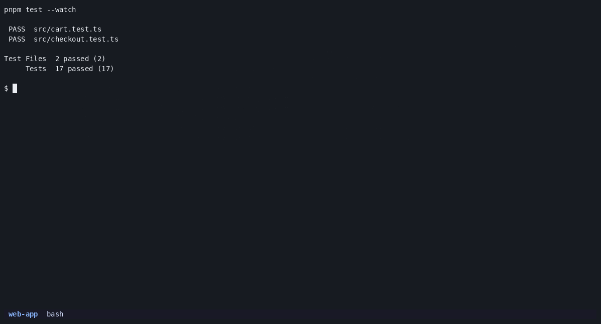

# tj

**t**mux **j**ump — because you bind it to `prefix + j`.

[](https://github.com/aladagemre/tj/actions/workflows/lint.yml)
[](LICENSE)


An interactive tmux session picker, sorted by **most recently used** — not
alphabetically.

`tmux ls` + `tmux attach -t <name>` stops working once you keep more than a
dozen sessions around: the list is long, it is sorted by name, and the session
you actually want is almost always one of the last few you touched. `tj` puts
those on top, lets you fuzzy-filter them, and shows you each session's live
screen so you can recognise it without attaching.



- `●` current session · `○` attached by another client · `·` detached
- then: how long ago you last attached, window count, session directory
- the right pane is a live capture of that session's active pane

## Install

Requires `tmux` and [`fzf`](https://github.com/junegunn/fzf).

**With TPM** — the tmux plugin manager. This is the shortest path: it installs
the script *and* sets up the key binding.

```tmux
set -g @plugin 'aladagemre/tj'
```

Then `prefix + I` to install, and `prefix + j` opens the picker. To use a
different key or popup size:

```tmux
set -g @tj-key 'j'
set -g @tj-width '80%'
set -g @tj-height '75%'
```

**Just the file** — Linux, macOS, anything with bash. `tj` is a single script,
so downloading it *is* the install:

```sh
mkdir -p ~/.local/bin
curl -fsSL https://raw.githubusercontent.com/aladagemre/tj/main/tj -o ~/.local/bin/tj
chmod +x ~/.local/bin/tj
```

(No `curl … | bash` here on purpose — this way the file lands on disk where you
can read it before you run it.)

**Homebrew** — works on macOS and Linux:

```sh
brew install aladagemre/tap/tj
```

**Arch Linux** — a `PKGBUILD` is in [`packaging/`](packaging), not yet on the AUR.

---

If you installed without TPM, bind the popup yourself in `~/.tmux.conf`:

```tmux
bind j display-popup -E -w 80% -h 75% "$HOME/.local/bin/tj"
```

Reload with `tmux source-file ~/.tmux.conf`.

## Usage

```
tj              open the picker
tj <name>       jump straight to a session (fuzzy; creates it if there's no match)
tj --help       key reference
```

Inside tmux, `prefix + j` opens the picker in a popup. Outside tmux it attaches
instead of switching, so the same command works from a fresh terminal.

| key    | action                                      |
|--------|---------------------------------------------|
| type   | fuzzy filter                                |
| enter  | attach (outside tmux) / switch (inside)     |
| ctrl-x | kill the highlighted session                |
| ctrl-n | create a new session named after your query |
| ctrl-/ | toggle the preview pane                     |
| esc    | quit                                        |

## Remote sessions

List and enter tmux sessions on other machines alongside your own. Put one host
per line in `~/.config/tj/hosts`:

```
prod
dev
user@build.example.com
```

Entries are passed straight to `ssh`, so `~/.ssh/config` aliases work. `TJ_HOSTS="prod dev"` overrides the file.

Remote sessions appear below your local ones with the host in its own column.
Picking one hands your terminal to the remote tmux rather than nesting one tmux
inside another, so your prefix key keeps working normally; detaching there
(`prefix + d`) brings you back to the session you left.

Two things worth knowing:

- Listing uses `ssh -o BatchMode=yes`, so it needs key-based auth. A host that
  would prompt for a password shows as unreachable. Entering a session uses a
  normal `ssh -t`, so passwords and 2FA still work there.
- `local` is reserved as the label for this machine and cannot name a host.

With no hosts configured tj never runs `ssh` and behaves exactly as it always has.

## How it works

Sessions are ordered by tmux's own `session_last_attached`, falling back to
`session_created` for sessions that have never been attached. Everything else is
`fzf`: the script re-invokes itself for `--list` (so `ctrl-x` can reload the list
after a kill) and for `--preview`.

It is one self-contained bash script with no dependencies beyond `tmux` and
`fzf`, and it works on both GNU and BSD/macOS userlands.

## How it compares

tmux already ships with a session tree — `prefix + s` — and it is genuinely
good: it previews sessions and it is always there. What `tj` adds is ordering
by when you last attached, plus fuzzy filtering, which is what starts to matter
somewhere north of a dozen sessions.

[`sesh`](https://github.com/joshmedeski/sesh) is the fuller-featured take on
this idea. Its own README leads with zoxide integration and per-project session
configuration, so if you want session *management* — starting sessions from
directories and config files — reach for that instead. `tj` is deliberately
smaller: one file, one job, no config file, nothing to learn beyond three keys.

## License

MIT
